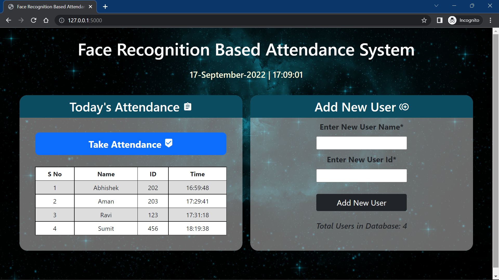

# Face Recognition Based Attendance System

A Flask web application that records attendance by recognising faces from the
camera of the device you open the page on (phone, tablet or laptop browser).

Blog post with a detailed explanation: https://machinelearningprojects.net/face-recognition-based-attendance-system/



## Features

- Register users (name + numeric ID) by capturing face images from the browser camera
- Take attendance: each person is recorded once per day, with the time
- Unknown faces are rejected instead of being matched to the nearest registered person
- Manage (list and delete) registered users
- Daily attendance stored as CSV files in `Attendance/`

## Requirements

- Python 3.10 to 3.13
- A browser with camera access (Chrome on Android works)

## Setup

```bash
python -m venv .venv
source .venv/bin/activate          # Windows: .venv\Scripts\activate
pip install -r requirements.txt
```

## Running

Development:

```bash
python app.py                      # http://127.0.0.1:5000
```

Production (no debug mode):

```bash
waitress-serve --host=0.0.0.0 --port=8000 app:app
```

### Camera access in the browser

Browsers only allow camera access on a secure page. That means you must open the
app as **`http://localhost:PORT`** (or over HTTPS). Opening it by IP address
(for example `http://192.168.1.5:5000`) will block the camera.

### Pixel phone (built-in Linux terminal)

1. Start the app bound to all interfaces: `HOST=0.0.0.0 PORT=5000 python app.py`
2. In the Terminal app settings, open **Port control** and enable port 5000.
3. Open `http://localhost:5000` in Chrome on the phone and allow the camera when asked.

## Configuration (environment variables)

| Variable | Default | Meaning |
|---|---|---|
| `RECOGNITION_THRESHOLD` | `70` | Maximum LBPH distance accepted as a match. Lower is stricter |
| `CONFIRM_FRAMES` | `8` | Consecutive matching frames required before attendance is marked |
| `SESSION_SECONDS` | `300` | Maximum length of one attendance session in the browser |
| `HOST` / `PORT` | `127.0.0.1` / `5000` | Address for the built-in development server |
| `FLASK_DEBUG` | off | Set to `1` only in development |

If too many people are wrongly marked "Unknown", raise `RECOGNITION_THRESHOLD`
slightly. If strangers are being accepted, lower it.

## How recognition works

1. **Capture**: the browser sends camera frames to the server, which does all detection and recognition.
2. **Detection**: OpenCV's Haar cascade finds faces. Histogram equalisation is applied first to help in poor lighting, and only the largest face in view is used.
3. **Preprocessing**: each face is converted to grayscale, resized to 100×100, contrast-normalised with CLAHE and lightly blurred. Training and live recognition use the same steps.
4. **Recognition**: a Local Binary Patterns Histograms (LBPH) model, which is robust to lighting changes. Faces whose distance exceeds the threshold are labelled "Unknown".
5. **Confirmation**: attendance is recorded only after the same person is recognised in several consecutive frames.

## Data and privacy

- Face images and the trained model are stored in `data/`, which the web server does not serve publicly.
- Attendance CSVs are stored in `Attendance/`.
- The app is intended for use on a trusted local network. Add authentication (for example, a reverse proxy with login) before exposing it to others. Registration and deletion currently have no login.
- Obtain consent from people before registering their face, and follow local biometric-data laws.

## Upgrading from the previous version

- Move the old `static/faces/` folder to `data/faces/`. The old `static/` model file is no longer used. The new model is built automatically from the faces in `data/faces/`.
- Users are stored as `Name_ID` folders, and names containing underscores are rejected.

## Project structure

```
app.py                              Flask app, API and recognition logic
static/camera.js                    Browser camera helper
templates/home.html                 Attendance dashboard and registration form
templates/attendance.html           Live attendance page (browser camera)
templates/register.html             New-user capture page (browser camera)
templates/listusers.html            Registered users page
haarcascade_frontalface_default.xml Face detector
Attendance/                         Daily attendance CSVs (created automatically)
data/faces/                         Registered face images (created automatically)
data/face_model.yml, labels.json    Trained model (created automatically)
```
